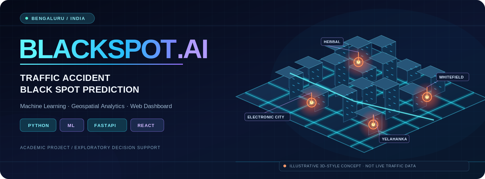
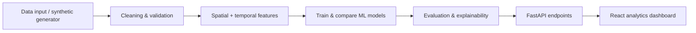

<div align="center">



<br />

# ⚡ BLACKSPOT.AI

### Traffic Accident Black Spot Prediction · Bengaluru

**Explore accident patterns. Train predictive models. Visualize potential road-risk hotspots.**

[](data_pipeline/)
[](ml_models/)
[](backend/)
[](traffic-blackspot-frontend/)

[**🔎 Explore the Code**](#-repository-structure) · [**🧠 ML Workflow**](#-how-it-works) · [**🚀 Run Locally**](#-getting-started) · [**🗺️ UI Prototype**](#-interactive-area-explorer-preview)

</div>

---

> [!IMPORTANT]
> **Data transparency:** The included data pipeline generates **synthetic Bengaluru-style accident records by default**. These are **not verified official accident records**. Any model metrics from synthetic data must not be described as real-world predictive performance. The banner above is **concept artwork**, not a real traffic map or live traffic visualization.

## 🌌 The project

**BLACKSPOT.AI** is an academic, end-to-end machine learning and web application for exploring road-accident patterns and potential black spots in Bengaluru, India.

It brings together a **Python data pipeline**, **classification model training and evaluation**, a **FastAPI service**, and a **React + Vite dashboard** for geospatial exploration and analytics.

**Goal:** Build a reproducible workflow to prepare road-accident data, engineer spatial and temporal features, compare classification models, expose API endpoints, and visualize the results. The project is intended for **learning, exploratory analysis, and decision-support demonstrations**—not emergency response or official road-safety decisions.

## 🗺️ Interactive area explorer preview

<div align="center">

**📍 Electronic City &nbsp; · &nbsp; 📍 Whitefield &nbsp; · &nbsp; 📍 Hebbal &nbsp; · &nbsp; 📍 Yelahanka**

[](https://blackspot-ai-bengaluru-explorer.silkyaudio9.chatgpt.site)

</div>

The **separate UI prototype** allows selection of these four Bengaluru areas and updates its map and location panel. The preview is **private and may require ChatGPT sign-in**. It is **not yet a publicly accessible production deployment**, and its latest code is not necessarily included in this repository.

**Traffic congestion and accident risk are different metrics.** A reliable congestion percentage needs a live traffic-data source; a validated accident-risk percentage needs an appropriate trained model and dataset. Missing values should be shown as unavailable—not invented.

> **README vs. web app:** GitHub READMEs can display images, GIFs, and links, but they cannot run an interactive React map. Click the dashboard link to use the area-selection interface.

## ✨ What's inside

| Layer | What it does |
| :--- | :--- |
| 🧹 **Data pipeline** | Synthetic-data generation, data loading, cleaning, validation, feature engineering, preprocessing, and visualization |
| 🧠 **Machine learning** | Logistic Regression, Random Forest, XGBoost, LightGBM, model comparison, threshold optimization, and optional SHAP explainability |
| ⚙️ **Backend** | FastAPI endpoints for health, predictions, black spots, analytics, and model information |
| 🖥️ **Frontend** | React + Vite pages for dashboard, map, analytics, predictions, upload, and settings |
| 🧪 **Testing** | pytest test suites for the pipeline, ML modules, and backend |

## 🔁 How it works



<details>
<summary><strong>📚 Expand the methodology</strong></summary>

1. **Collect or generate data** — use the included synthetic generator by default; external road-network and accident-related inputs can be loaded where configured.
2. **Clean and validate** — normalize dates, validate coordinates, handle invalid or duplicate records, and check data quality.
3. **Explore patterns** — inspect distributions and spatial/temporal trends.
4. **Engineer features** — create spatial, temporal, road-related, and environmental variables.
5. **Preprocess** — encode categories, scale configured numerical fields, split the data, and apply configured class-balancing methods.
6. **Train models** — fit the supported classifiers and optionally tune hyperparameters.
7. **Evaluate and explain** — compare metrics and produce SHAP explanations where configured.
8. **Serve and visualize** — expose backend endpoints and display maps, charts, and prediction information in the frontend.

</details>

## 🧰 Tech stack

| Area | Technologies |
| :--- | :--- |
| Languages | Python, JavaScript, HTML, CSS |
| Data | Pandas, NumPy, SciPy |
| Geospatial | GeoPandas, OSMnx, Shapely, Folium |
| Machine learning | scikit-learn, XGBoost, LightGBM, imbalanced-learn |
| Explainability / tuning | SHAP, MLflow, Optuna |
| API | FastAPI, Pydantic, Uvicorn |
| Web | React, Vite, React Router, Zustand, TanStack Query |
| Mapping / charts | Leaflet, React-Leaflet, Recharts |
| Storage | SQLite, SQLAlchemy, Parquet, PyArrow |
| Testing / tooling | pytest, Docker, Docker Compose |

## 🗂️ Repository structure

```text
.
├── data_pipeline/                  # Cleaning, validation, features, pipeline
│   ├── src/
│   ├── tests/
│   ├── pipeline.py
│   ├── config.yaml
│   └── requirements.txt
├── ml_models/                      # Training, evaluation, explainability
│   ├── src/
│   ├── tests/
│   ├── train.py
│   ├── evaluate.py
│   ├── explain.py
│   └── requirements.txt
├── backend/                        # FastAPI app and tests
│   ├── app/
│   ├── tests/
│   ├── Dockerfile
│   └── requirements.txt
├── traffic-blackspot-frontend/     # React + Vite app
│   ├── src/
│   ├── public/
│   └── package.json
├── assets/
│   └── blackspot-banner.png        # Concept banner used in this README
└── README.md
```

## 🚀 Getting started

> These components have separate dependencies. Run each command block from the **repository root**, using a separate terminal when running the backend and frontend together. A complete prediction workflow requires prepared data and compatible exported model artifacts.

<details>
<summary><strong>01 — Data pipeline</strong></summary>

```bash
cd data_pipeline
python3 -m venv .venv
source .venv/bin/activate
python -m pip install --upgrade pip
pip install -r requirements.txt
python pipeline.py --stage all
```

The generator produces **synthetic** accident records by default. Review `data_pipeline/config.yaml` and `data_pipeline/README.md` before running. Run `deactivate` before changing to another component's virtual environment.

</details>

<details>
<summary><strong>02 — Train and evaluate models</strong></summary>

After the pipeline has generated the expected train/test files, from the repository root:

```bash
cd ml_models
python3 -m venv .venv
source .venv/bin/activate
python -m pip install --upgrade pip
pip install -r requirements.txt
python train.py --model all
```

Optional flags documented in `ml_models/train.py` include `--tune`, `--cv`, and `--export`. Model artifacts and metadata required by the backend are **not included in this repository snapshot**. Review the model configuration and exported paths before enabling prediction endpoints.

</details>

<details>
<summary><strong>03 — FastAPI backend</strong></summary>

From the repository root:

```bash
cd backend
python3 -m venv .venv
source .venv/bin/activate
python -m pip install --upgrade pip
pip install -r requirements.txt
cp .env.example .env
uvicorn app.main:app --reload --host 127.0.0.1 --port 8000
```

When the server is running, visit [http://127.0.0.1:8000/docs](http://127.0.0.1:8000/docs) for API documentation. Do **not** commit `.env`, passwords, or API keys.

</details>

<details>
<summary><strong>04 — React frontend</strong></summary>

Open a separate terminal at the repository root:

```bash
cd traffic-blackspot-frontend
npm install
npm run dev
```

Set the frontend API base URL according to the frontend source configuration. Use local environment files for machine-specific values and never commit secrets.

</details>

### 🧪 Run tests

After installing each component's dependencies, run tests from its folder:

```bash
cd data_pipeline && pytest tests/ -v
cd ../ml_models && pytest tests/ -v
cd ../backend && pytest tests/ -v
```

## 📊 Data, evaluation & limitations

- **Synthetic by default:** The pipeline generates illustrative Bengaluru-style records, not verified official accident records.
- **No verified real-world benchmark:** The repository snapshot does not include a verified official accident dataset or exported trained model artifacts.
- **Existing evaluation artifact:** `ml_models/outputs/reports/model_comparison.csv` exists, but its metrics must be reproduced and the evaluation design verified before they are reported as real-world performance.
- **No fabricated percentages:** Do not present concept-image hotspots, simulated data, or unavailable traffic feeds as measured congestion or validated accident risk.
- **Privacy and security:** Never upload private datasets, credentials, local `.env` files, or large generated artifacts.
- **Safety:** Geospatial findings and black-spot definitions require appropriate validation against official standards and real-world data before operational use.

## 🔮 Roadmap

- [ ] Integrate a documented, appropriately licensed real-world accident dataset.
- [ ] Reproduce model training with leakage-safe validation and verified evaluation metrics.
- [ ] Integrate the four-area UI prototype into the main React frontend.
- [ ] Connect a licensed live traffic feed for congestion metrics.
- [ ] Add authentic dashboard screenshots and a reproducible demo dataset.
- [ ] Document model export and end-to-end local startup.
- [ ] Deploy a public demo with security, monitoring, and data governance.

## 👨‍💻 Author

**Vinay Warad**  
B.E. — Computer Science and Engineering (Data Science)  
Interested in **Data Analytics · Data Science · Machine Learning**

[](https://github.com/vinaywarad)

---

<div align="center">

**Built to explore safer-road insights through data and machine learning.**

<sub>Academic demonstration only. Not intended for emergency response or standalone traffic-safety decisions.</sub>

</div>
